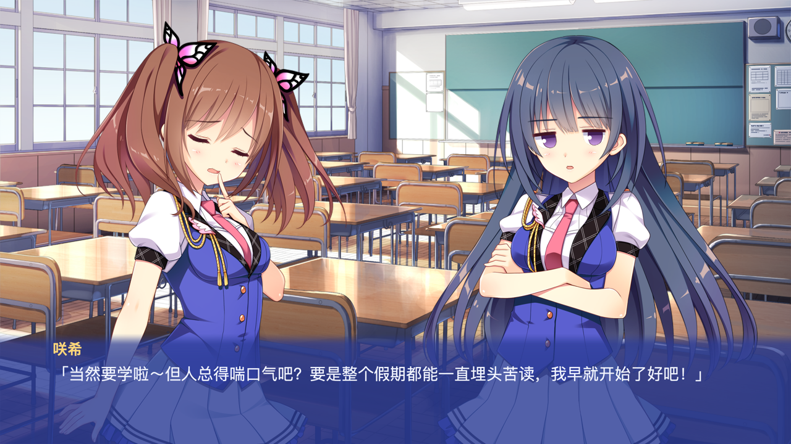

# Koikari Metal

[](https://github.com/Greendot-galgame/koikari-metal/actions/workflows/ci.yml)
[](LICENSE)
[](koikari-metal/BUILD-AND-RUN.md)

[构建运行](koikari-metal/BUILD-AND-RUN.md) · [测试](koikari-metal/docs/TESTING.md) · [路线图](ROADMAP.md) · [变更记录](CHANGELOG.md) · [参与贡献](CONTRIBUTING.md)

用 **Rust + Metal** 实现的原生 macOS KiriKiri/KAG 视觉小说兼容运行时。直接只读加载使用者合法持有的 XP3 资源，用原生窗口、CoreText 与音频管线呈现剧情。

> **开发中，不是完整原版引擎。** 当前重点是本地资源读取、剧情/分支、图层和存档兼容；影片、复杂动画时序与原版场景回想仍待实现。`B` 目前打开的是对话历史，不是原版回想模式。



*截图仅作界面说明，相关游戏内容的权利属于原权利人；代码 MIT 许可不覆盖截图。*

## 能做什么

| 能力 | 当前状态 |
|---|---|
| XP3 索引、分段/zlib、Adler-32 与确定性资源覆盖 | 已实现；归档只读 |
| 剧情、显式路线选择、受限表达式、章节继续 | 已实现当前已验证脚本子集；未知语义明确报错 |
| Metal 图层、表情/头像、Retina 与缩放命中、LRU 纹理缓存 | 已实现并有选定像素/几何回归 |
| Vorbis 音乐/音效、Opus 语音 | 已实现；缺失可选语音静默继续，真实损坏保留诊断 |
| JSON 快存/快读、原资源/追加包存档隔离 | 已实现；标题页不会保存空进度 |
| 影片、复杂动画/转场时序、原版场景回想 | **尚未完整实现** |
| 原始 TJS、Windows EXE/DLL、Steam 组件 | **不执行/不加载** |

## 从源码开始

已验证开发工具链是 **Rust 1.95.0**，本机验证平台为 Apple Silicon macOS。Objective-C shim 的编译目标为 macOS 12.0+；不表示所有 macOS 版本及 Intel 设备都已人工验收。当前不提供 Windows、Linux 或 iOS GUI。

需要 Xcode Command Line Tools 和 Rust/rustup；依赖可能需要 CMake。普通 Git 克隆**不包含预编译程序或游戏资源**。

```sh
git clone https://github.com/Greendot-galgame/koikari-metal.git
cd koikari-metal/koikari-metal
cargo build --release --locked

# 改成你合法持有的游戏目录；原始文件无需搬进仓库
export KOIKARI_GAME_ROOT="/path/to/owned-game"
./target/release/koikari-metal --root "$KOIKARI_GAME_ROOT"
```

资源优先级（低 → 高）：

```text
data.xp3 → adult.xp3（可选）→ patch.xp3（可选）
```

新资源包可能替换剧本，不能随意混读版本不同的存档。继续基础资源版本时使用 `--base-only`。完整环境、存档位置与命令说明见[构建运行指南](koikari-metal/BUILD-AND-RUN.md)和[项目使用说明](koikari-metal/README.md)。

## 验证与范围

2026-11-11 的本机私有资源审计通过 **124 项测试**，覆盖基础 95 章/追加 124 章、49,103 个剧情停点、60 条选择分支、219 个序列化检查点及 227 条 Vorbis 源初始化。它不是对全部画面/声音的人工验收，也不代表零 bug。

**GitHub CI 不含游戏资源，不能冒充上述完整验收。** 它检查公开源码的格式、正确性重点 Clippy、合成/无资源测试与 macOS 构建；真实剧情、媒体和 Metal 集成需要使用者在本机额外配置。

- [测试指南与复现命令](koikari-metal/docs/TESTING.md)
- [全面检查记录与剩余限制](koikari-metal/docs/COMPREHENSIVE-AUDIT-2026-11-11.md)
- [场景指令兼容范围](koikari-metal/docs/SCENE-LIFECYCLE.md)

## 仓库导航

```text
.
├─ koikari-metal/           Rust 程序与 Cargo 项目
│  ├─ src/                 归档、脚本/运行时、渲染、音频与界面
│  ├─ native/              AppKit / CoreText shim
│  ├─ tests/               合成、私有资源可选与 Metal 回归
│  └─ docs/                使用、验证与历史修复记录
├─ diagnostics/            只读资源检查工具，不含提取结果或日志
└─ .github/                CI 与协作模板
```

欢迎先阅读[贡献指南](CONTRIBUTING.md)。普通缺陷通过 [Issues](https://github.com/Greendot-galgame/koikari-metal/issues/new/choose) 提交；安全问题请按[安全报告流程](SECURITY.md)处理。后续重点是可跳过的影片、动画时间轴与原版回想导航，当前不会将这些标记为已完成。

## 许可与资源

原始代码采用 [MIT](LICENSE)，第三方依赖遵循各自许可。原始游戏资源、剧本、字体、音视频、角色图像及文档中的游戏截图**不在 MIT 授权范围内**，详见[素材与第三方说明](NOTICE.md)。

请勿向仓库或 Issue 上传 XP3、原始素材、存档、密钥、完整剧情台词或可执行的原版插件。本项目不提供资源下载，也不授予使用任何游戏素材的权利。
