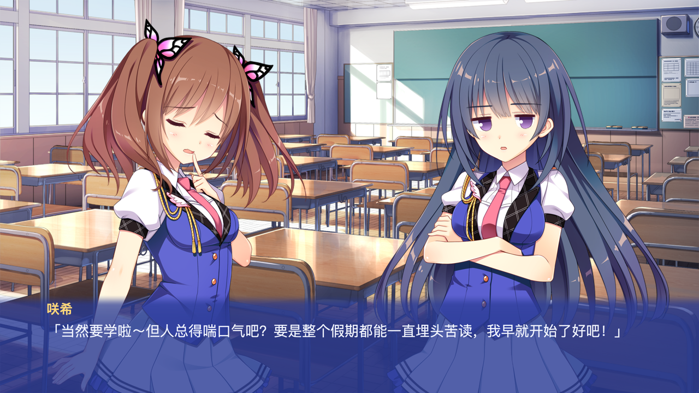

# koikari-metal — 恋爱，我就借走咯 · 原生 macOS Rust + Metal 运行时

用 Rust 重写的 KiriKiri2 / KAG 运行时，直接读取玩家自己拥有的 `data.xp3` / `patch.xp3`，
用 Metal 渲染画面、用 CoreAudio(rodio/cpal) 播放音频。

**完全不包含 Steam 组件。** 不加载 `steam_api.dll`、`plugin/krkrsteam.dll`、
`plugin/DrawDeviceForSteam.dll`，不读取 `savedata/steam_autocloud.vdf`，
也不运行任何 Windows PE / 原生插件 DLL。



## 快速开始

```sh
cd "/Users/greenhats/Downloads/koikari-metal-delivery/koikari-metal"

# 交付包已有 Apple Silicon 可执行程序，无需重新编译
./koikari-metal --root "/Users/greenhats/Documents/租借男友"

# 修改源码后再构建（Xcode Command Line Tools + Rust 1.85+）
./tools/cargo.sh build --release
./target/release/koikari-metal --root "/Users/greenhats/Documents/租借男友"
```

更新后请关闭旧游戏进程再重新启动。资源无需移动；同目录的可选追加归档会自动加载，详见[追加归档说明](<docs/ADDITIONAL-ARCHIVE.md>)。

追加包会替换部分脚本，所以默认使用独立的追加包存档目录，不混读旧存档。要继续原有 v1 快速存档，请在启动命令追加 `--base-only`，该模式保留原资源指纹和旧存档目录；旧档中的重叠头像仍会迁移为单个前景头像。

`tools/cargo.sh` 只是把 `CARGO_HOME` / `CARGO_TARGET_DIR` 指到项目目录内，
避免写入 `~/.cargo`；如果你的环境本来就能正常 `cargo build`，直接用 cargo 也可以。

## 操作

| 按键 / 操作 | 功能 |
|---|---|
| 空格 / 回车 / 鼠标左键 | 推进对话、确认 |
| 数字键 1–9 | 选择分支 |
| Ctrl（按住） | 快进 |
| A | 自动播放 |
| B | 回忆（最近 6 条） |
| H | 隐藏 / 显示文本框 |
| F5 / F9 | 快速存档 / 快速读取；成功提示为青绿色，2.5 秒后自动消失 |
| Esc | 打开 / 关闭菜单 |

默认存档位置：

```text
原资源 / --base-only：~/Library/Application Support/KoikariMetal/quicksave.json
加载追加归档：~/Library/Application Support/KoikariMetal/with-additional/quicksave.json
```

可用环境变量 `KOIKARI_SAVE_DIR` 显式指定其他目录；指定后由使用者自行分开不同资源版本。

## 命令行

```
koikari-metal [--root <游戏目录>]

# 无窗口渲染一帧到 PNG（用于验证/截图，不需要窗口服务器）
koikari-metal --capture shot.png --advance 120 --size 2560x1440
koikari-metal --capture title.png --title
koikari-metal --preview-texture stb6_s2_1_1 --capture tex.png

# 逐次实际渲染，强制缓存回收后核对指定剧情停点（不执行原版 TJS）
koikari-metal --root "/Users/greenhats/Documents/租借男友" \
  --scenario scenario/main/0_2.ks --line 306 --capture-replay \
  --texture-budget-mib 32 --size 1280x720 --capture regression.png

# --label 选择章节标签，--choice 2 只选择第一次遇到的分支的第2项
# --line 是该章节脚本行号，须从章节开头正常执行，不跳过图层设置
```

## 实现结构

```
src/
├─ archive.rs   XP3 索引/分段解析，zlib 解压 + Adler-32 校验（只读，不重打包）
├─ assets.rs    data.xp3 + patch.xp3 叠加覆盖；路径别名（"bg1_0" → bgimage/bg1_0.webp）
├─ script.rs    KAG 词法/语法：标签、label、[if]/[jump]、受限表达式求值
├─ runtime.rs   场景状态机：背景、立绘、对话、分支、BGM/语音/SE、存档快照
├─ renderer.rs  Metal：单管线 textured quad + 采样器；窗口和离屏共用合成路径
├─ texture_cache.rs  单一纹理驻留事实来源、LRU 和本帧图层保护
├─ ui.rs        绘图与点击共用的等比变换、选项矩形、头像文字避让
├─ debug_capture.rs  指定章节/脚本行的连续渲染、低缓存压力测试参数
├─ text.rs      CoreText/PingFang SC 光栅化 CJK 文本
├─ audio.rs     Ogg Vorbis（流式）与 Ogg Opus（解码为 PCM）播放，BGM/语音/SE 三总线
├─ save.rs      存档 JSON（校验版本 + 资源指纹）
├─ lib.rs       对外 API
└─ main.rs      winit 0.30 + CAMetalLayer 窗口、标题/游戏/菜单/回忆界面、输入
native/text.m   AppKit/CoreText 平台 shim（唯一的 ObjC 代码）
```

### 关键实现要点（踩过的坑）

1. **XP3 格式**：魔数 11 字节之后**直接**是索引偏移（`u64`），没有版本字段。
   `segm` 记录是 **28 字节**（`u32 flag, u64 offset, u64 orig, u64 stored`）。
   归档没有加密；`adlr` 只是 Adler-32。
2. **zlib 流式解压**：只有把缓冲区里剩余的输入全部喂给解码器、且**没有更多输入**之后，
   才能传 `FlushDecompress::Finish`。在输出缓冲区还装不下剩余数据时传 `Finish`，
   miniz_oxide 会误报 `invalid zlib stream`。
3. **预乘 alpha**：管线混合用 `source=One, dest=OneMinusSourceAlpha`（预乘），
   而 WebP/PNG 存的是**直通 alpha**；必须在上传前把 RGB 乘上 A，
   否则透明像素的 `RGB=255` 会把整块区域刷成白色。
4. **KAG 属性重复**：原作 `scenario/main/0_15.ks` 里有一处 `@t_move lay=@t_move lay=5`。
   KAG 用字典存属性，重复键后者覆盖前者——解析器必须照做，不能报错中断整章。
5. **立绘分层**：`stb*`（身体）+ `st*`（表情）+ `stc*`（腮红）三张图**同原点**叠加，
   无需额外偏移表。

## 已验证

- 2026-11-11 全面检查后 **124 个测试通过**；覆盖基础 95 章/追加 124 章、49,103 个停点、60 条选择分支、219 个序列化检查点，以及 227 条 Vorbis 音乐/音效初始化。已修复标题页 F5 覆盖风险、读档原子性、错误回报、音效残留及数值/调用边界等问题；见[全面检查报告与验证边界](<docs/COMPREHENSIVE-AUDIT-2026-11-11.md>)。
- 真实素材索引：15,051 + 20 条；对所读素材执行 Adler-32 校验，不声称扫描校验过所有归档载荷。
- 95 章、21,001 个剧情停点、1,969 个不同图层图片引用均可解析；12 张选择表的 29 条分支可推进。
- 用户报告的四个画面均重新捕获；32 MiB 缓存下逐次真实渲染与同停点单帧渲染的 PNG 完全一致。
- 实际窗口截帧验证：默认 1280×720 逻辑窗口 → 2560×1440 Retina drawable，不再重复乘 DPI。
- 所有选项的命中几何在 1x、Retina、缩放、方形和超宽窗口下通过自动测试；未宣称逐条进行系统鼠标实点。
- 原始归档始终只读：集成测试断言其 size 与 mtime 不变。

详细修复和复测边界见[图层修复说明](<docs/FIXES-2026-11-11.md>)和[语音红条修复说明](<docs/AUDIO-FIX-2026-11-11.md>)。资源包缺少的语音按无配音台词继续，不再弹永久红条；真实音频错误仍记录日志并限时提示。

## 已知限制

- 转场（`trans`/`ts`/`te`/`wt`）立即生效，画面震动不重现。有限立绘动作使用原定义的最终偏移，循环动作、延迟表情以及动作跨转场/立绘重建的时序仍未完整复刻；不是完整的原版引擎。
- 开场 MP4 影片不播放（`openvideo` 等命令跳过并记录诊断）。
- 不支持 TJS2 脚本执行：剧情驱动的数据（章节表、选择表、立绘宽度/位置表）用受限解析读取，
  其余 `.tjs` 仅作参考，不执行。
- Steam 相关命令（`achievement` 等）一律忽略并记录诊断。
- 语音是 `Ogg Opus`，用 `libopus` 解码；BGM/SE 是 `Ogg Vorbis`，流式播放。

## 许可与素材

本运行时只包含代码。所有图像、脚本、音乐、语音仍来自玩家本地的
`data.xp3` / `patch.xp3`，不复制、不修改、不重新分发。
